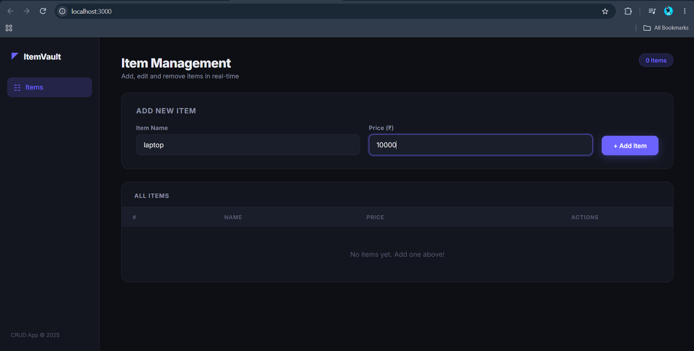
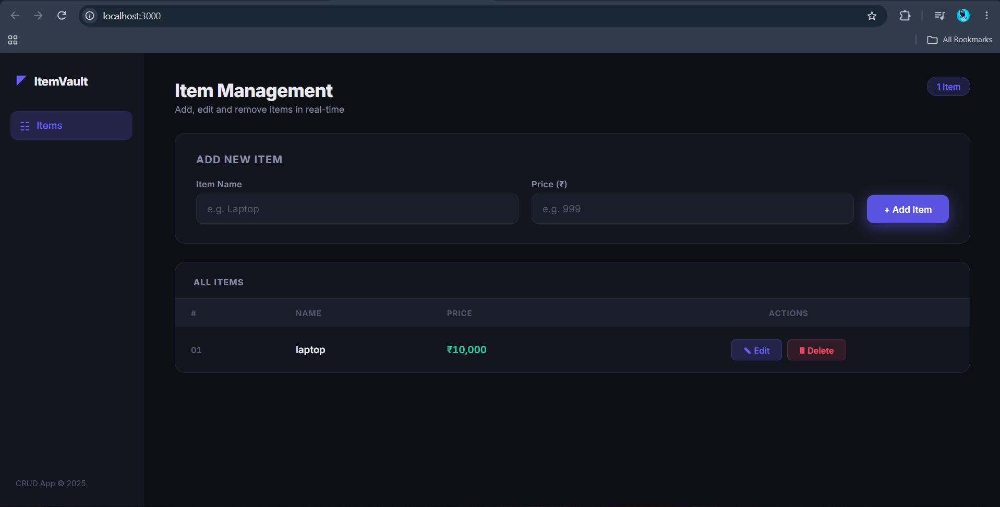
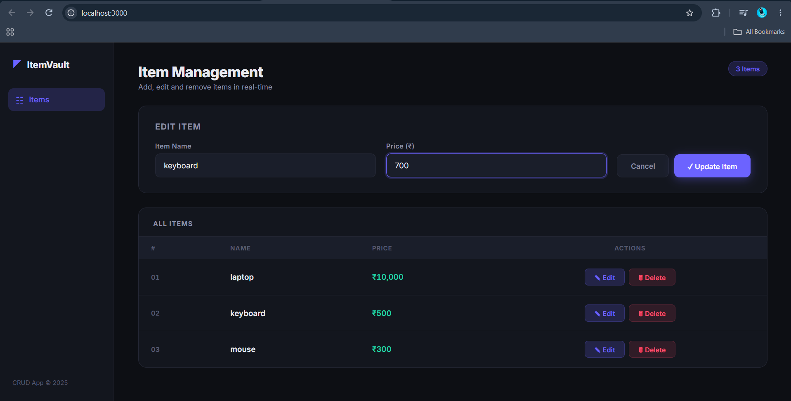
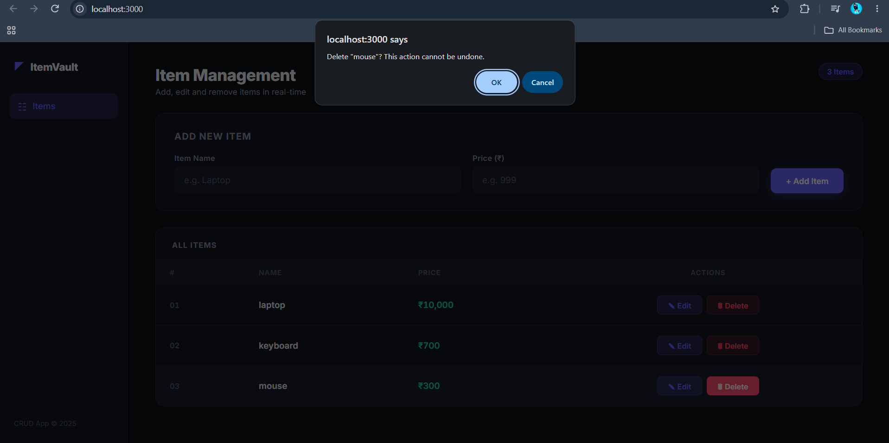

# ItemVault — CRUD Item Manager

A full-stack CRUD web application built with **Node.js**, **Express**, and **Vanilla JavaScript**. Features a modern dark-themed UI with a sidebar layout.

---

## 🚀 Tech Stack

| Layer    | Technology              |
|----------|------------------------|
| Backend  | Node.js + Express.js   |
| Frontend | HTML, CSS, JavaScript  |
| Storage  | In-Memory (Array)      |
| Font     | Inter (Google Fonts)   |

---

## ✨ Features

- ✅ **Add Items** — Add new items with name and price
- ✏️ **Edit Items** — Update existing item details inline
- 🗑️ **Delete Items** — Remove items with confirmation dialog
- 🔢 **Auto Serial Numbers** — IDs re-sequence automatically after delete
- 💰 **INR Formatting** — Prices displayed in Indian Rupee format (₹)
- 🏷️ **Live Item Count** — Badge updates in real-time
- 📱 **Responsive** — Works on all screen sizes

---

## 📸 Screenshots

### 1. Dashboard — Empty State


---

### 2. Adding an Item


---

### 3. Item Added Successfully


---

### 4. Edit Mode — Multiple Items


---

### 5. Delete Confirmation


---

## 🛠️ Getting Started

### Prerequisites
- [Node.js](https://nodejs.org/) installed

### Installation & Run

```bash
# 1. Go to the project folder
cd "anish mern 1"

# 2. Install dependencies
npm install

# 3. Start the server
npm start
```

Open your browser and visit 👉 **http://localhost:3000**

---

## 📁 Project Structure

```
anish mern 1/
├── server.js           ← Express backend (CRUD API)
├── package.json        ← Project config & dependencies
├── screenshots/        ← App screenshots
│   ├── screenshot-1.png
│   ├── screenshot-2.png
│   ├── screenshot-3.png
│   ├── screenshot-4.png
│   └── screenshot-5.png
└── public/             ← Static frontend files
    ├── index.html      ← Main HTML layout
    ├── style.css       ← Dark theme styling
    └── script.js       ← Frontend logic (fetch API)
```

---

## 🔌 API Endpoints

| Method | Endpoint      | Description              |
|--------|--------------|--------------------------|
| GET    | `/items`     | Get all items            |
| POST   | `/items`     | Create a new item        |
| PUT    | `/items/:id` | Update item by ID        |
| DELETE | `/items/:id` | Delete item by ID        |

---

## 👨‍💻 Author

**Anish** — MERN Task Project
